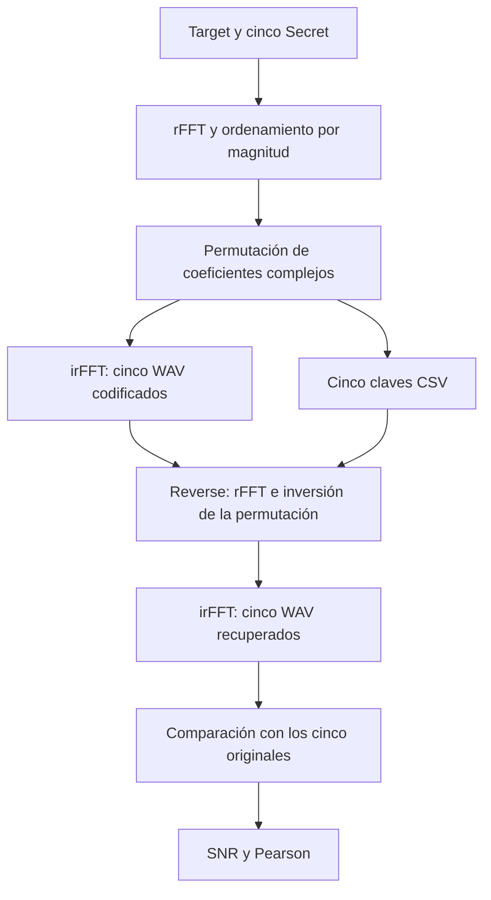
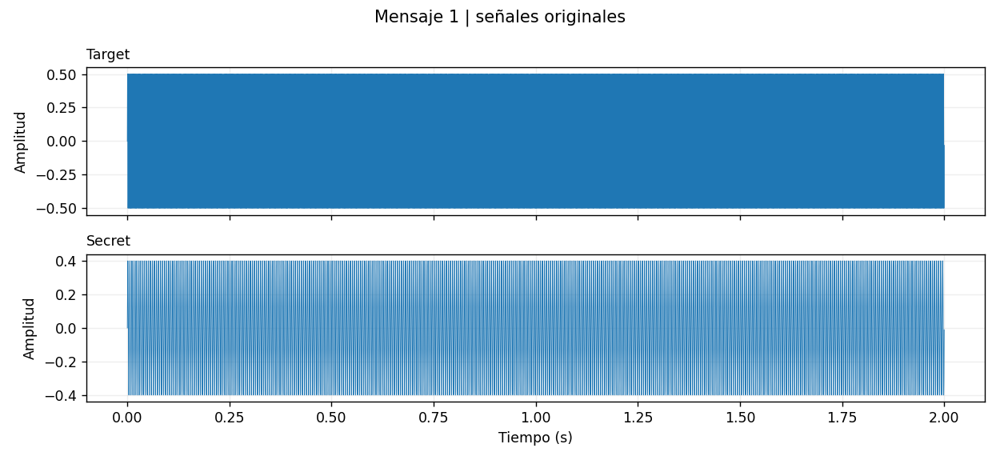
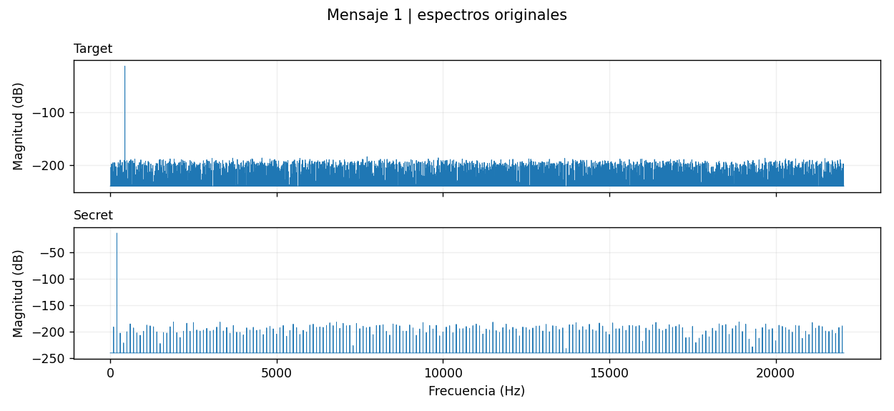
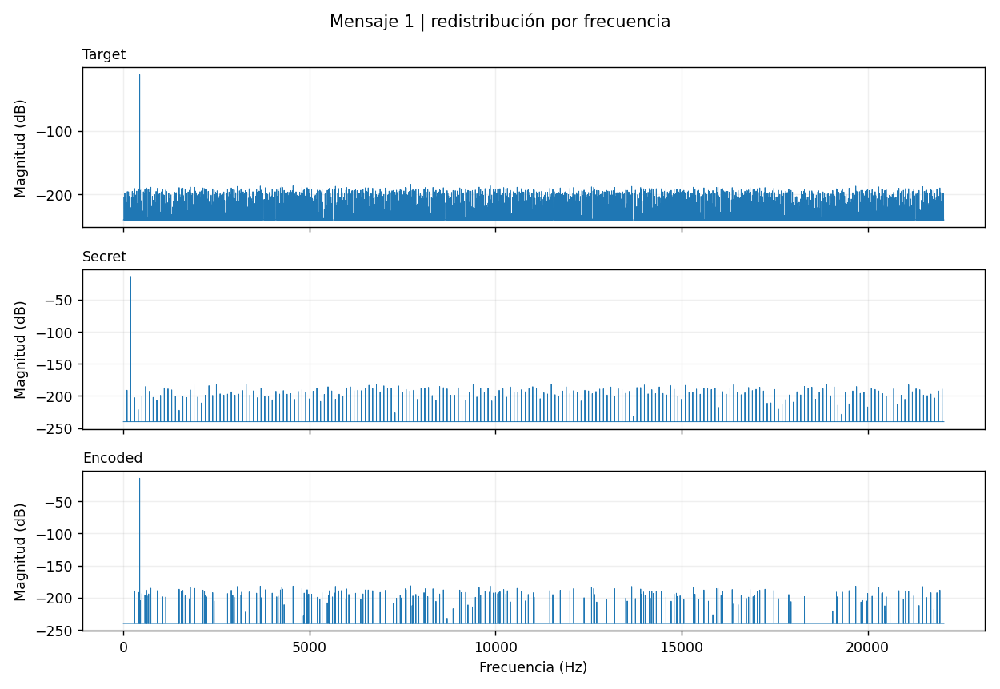
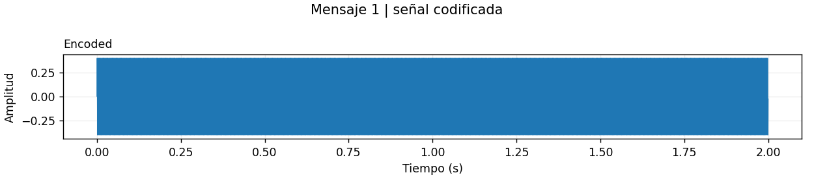

# Proyecto de Análisis de Señales
## Ocultamiento y recuperación de mensajes mediante permutación espectral de Fourier

**Institución:** Universidad Militar Nueva Granada (UMNG)  
**Facultad:** Ingeniería  
**Programa:** Ingeniería de Telecomunicaciones  
**Asignatura:** Análisis de Señales  
**Docente:** Dora María Ballesteros Larrotta  
**Integrantes:**

- María Camila Restrepo Cortés
- Juan Marco Angulo Pulido

**Año:** 2026

## 1. Introducción

Este proyecto estudia la relación entre los dominios temporal y frecuencial mediante la codificación y recuperación de cinco mensajes de audio. Se utiliza un audio de referencia (Target) para determinar el orden de las magnitudes de los coeficientes espectrales de cada mensaje secreto (Secret). A partir de ese orden se reorganizan los coeficientes complejos sin sustituir sus valores, y se genera una clave que permite invertir el procedimiento.

La implementación se divide en tres etapas: Imitation, Reverse y evaluación cuantitativa de la calidad de reconstrucción. El procedimiento permite estudiar los efectos de la redistribución espectral sobre la forma de onda y comprobar la reversibilidad del algoritmo. No constituye un sistema de cifrado seguro.

## 2. Objetivos

### Objetivo general

Implementar un procedimiento de codificación y recuperación de cinco mensajes de audio mediante la permutación de coeficientes complejos de Fourier y evaluar la fidelidad de las reconstrucciones mediante métricas de similitud.

### Objetivos específicos

- Representar las señales originales en los dominios temporal y frecuencial.
- Construir una clave de permutación por orden de magnitud que conserve los coeficientes complejos y mantenga fijos DC y Nyquist cuando corresponda.
- Generar cinco audios codificados y recuperar los mensajes con sus respectivas claves.
- Calcular la relación señal a ruido (SNR) y la correlación de Pearson, comparar los resultados e interpretar las diferencias.

## 3. Fundamento teórico

La transformada discreta de Fourier (DFT) expresa una señal de N muestras en términos de sus componentes de frecuencia:

$$
X[k]=\sum_{n=0}^{N-1}x[n]e^{-j2\pi kn/N}
$$

La FFT es un algoritmo eficiente para calcular la DFT. Para señales reales, `scipy.fft.rfft` conserva los coeficientes correspondientes a las frecuencias no negativas, aprovechando la simetría conjugada. El número de coeficientes es $\lfloor N/2\rfloor+1$. La función `irfft` reconstruye la señal temporal a partir de estos coeficientes, aprovechando la simetría conjugada del espectro. La expresión de la transformada discreta inversa es:

$$
x[n]=\frac{1}{N}\sum_{k=0}^{N-1}X[k]e^{j2\pi kn/N}
$$

Cada coeficiente $X[k]=a+jb$ contiene información de magnitud y fase. Su magnitud es $\sqrt{a^2+b^2}$ y su fase corresponde al argumento del número complejo. El algoritmo ordena por magnitud, pero desplaza el coeficiente complejo completo. DC representa la componente continua y, para una longitud par, Nyquist corresponde a la frecuencia $f_s/2$. Ambos permanecen fijos debido a que sus coeficientes deben ser reales para una señal real. Si se permutaran con coeficientes complejos interiores, la síntesis mediante `irfft` podría descartar sus componentes imaginarias y romper la reversibilidad.

La clave K establece una correspondencia uno a uno entre los índices del espectro codificado y los índices del espectro original. Por tanto, la operación es reversible en aritmética exacta.

## 4. Herramientas y características de las señales

El código se ejecuta en Python mediante Google Colab y utiliza NumPy para operaciones vectoriales, SciPy (`fft`, `io.wavfile`) para el análisis espectral y lectura/escritura de WAV, Matplotlib para las gráficas, IPython para reproducir audio y `pathlib`, `csv` y `zipfile` para organizar los archivos.

| Parámetro | Valor |
|---|---:|
| Número de mensajes secretos | 5 |
| Canales | 1 (mono) |
| Frecuencia de muestreo | 44 100 Hz |
| Muestras por señal | 383 184 |
| Duración | 8.688980 s |
| Coeficientes rFFT por señal | 191 593 |
| Frecuencia de Nyquist | 22 050 Hz |
| Resolución frecuencial ($f_s/N$) | 0.1151 Hz |
| Formato de los WAV codificados y recuperados | Punto flotante de 32 bits |

Las señales originales enteras se convierten a punto flotante utilizando la escala de su tipo de dato, no dividiendo cada audio por su propio pico. Esta decisión permite comparar los originales y las reconstrucciones en una escala común.

## 5. Metodología



### 5.1. Imitation

El notebook [`Imitation.ipynb`](Imitation.ipynb), cuando no encuentra el Target en la carpeta `Originales/`, extrae `target.wav` y los cinco `secret*.wav` de `Entradas_Originales.zip`. Comprueba que los audios sean mono y, para cada secreto, que tengan la misma frecuencia de muestreo y longitud que el Target. Construye los ejes de tiempo y frecuencia mediante `np.arange(N)/fs` y `rfftfreq(N, 1/fs)`.

El espectro de referencia se calcula una sola vez. El conjunto P excluye DC y el último coeficiente cuando N es par. Para cada secreto se calculan los órdenes de magnitud del Secret y del Target. En el código real, `I1` e `I2` ya contienen índices absolutos del espectro, por lo que la clave se construye de la siguiente manera:

```python
T = rfft(target)
P = np.arange(1, len(T) - (N % 2 == 0))
I2 = P[np.argsort(np.abs(T[P]), kind='stable')]

S = rfft(s)
I1 = P[np.argsort(np.abs(S[P]), kind='stable')]
K = np.arange(len(S))
K[I2] = I1
E = S[K]
encoded = irfft(E, n=N)
```

`K[j]` indica la posición original del coeficiente ubicado en la posición j del espectro reorganizado. El algoritmo comprueba que la clave sea una permutación válida, que DC y Nyquist permanezcan fijos y que se conserve el conjunto de magnitudes. No reemplaza los coeficientes del Secret por los del Target.

En términos matemáticos, la codificación utiliza $E[j]=S[K[j]]$, de modo que la recuperación se efectúa mediante $\hat{S}[K[j]]=E[j]$. El ordenamiento estable (`kind="stable"`) permite mantener un criterio determinista cuando existen magnitudes iguales.

El audio codificado se almacena como WAV `float32` y la clave como CSV de una columna con encabezado `original_index`. Los cinco pares se incluyen en [`Paquete_Encoded_FFT.zip`](Paquete_Encoded_FFT.zip).

Se generan cuatro figuras por mensaje (20 en total) en `Graficas/`:

| Archivo (i = 1 a 5) | Contenido |
|---|---|
| `i_tiempo.png` | Target y Secret en el tiempo. |
| `i_espectro.png` | Magnitudes espectrales originales. |
| `i_espectro_reorganizado.png` | Espectros de Target, Secret y Encoded. |
| `i_encoded.png` | Forma de onda del audio codificado. |

Las gráficas espectrales utilizan $20\log_{10}(\max(|X[k]|/N,10^{-12}))$, como representación relativa en dB; no se trata de una medición calibrada de nivel sonoro.

### 5.2. Reverse

El notebook [`Reverse_FFT_adaptado.ipynb`](Reverse_FFT_adaptado.ipynb) adapta el núcleo del procedimiento de recuperación mostrado en el material de la docente para procesar los cinco pares de archivos. No necesita el Target ni los originales para efectuar la recuperación.

Para cada mensaje se carga el WAV codificado y la clave CSV; `skiprows=1` omite el encabezado. Se verifica que la clave contenga todos los índices del espectro sin repeticiones. La inversión se realiza mediante:

```python
X_encoded = rfft(encoded.astype(float))
X_recovered = np.empty_like(X_encoded)
X_recovered[key] = X_encoded
recovered = irfft(X_recovered, n=len(encoded))
```

La asignación `X_recovered[key] = X_encoded` restituye cada coeficiente a su ubicación original. A continuación, `irfft` vuelve al dominio temporal. Los cinco mensajes se guardan como WAV `float32` dentro de [`Paquete_Recuperados.zip`](Paquete_Recuperados.zip). El notebook incluye reproductores para realizar la comprobación auditiva. La recuperación no requiere conocer el orden de magnitud del Target: la correspondencia ya está registrada en cada clave. El notebook original de la docente se cita en las referencias; su copia íntegra debe añadirse por separado cuando esté disponible.

### 5.3. Evaluación cuantitativa

El notebook [`Metricas_Similitud.ipynb`](Metricas_Similitud.ipynb) compara cada secreto original con su correspondiente audio recuperado, verificando que coincidan la frecuencia de muestreo y la forma del arreglo de muestras.

La relación señal a ruido de reconstrucción se calcula como:

$$
\mathrm{SNR}=10\log_{10}\left(\frac{\sum_{n=0}^{N-1}x[n]^2}{\sum_{n=0}^{N-1}(x[n]-\hat{x}[n])^2}\right)
$$

La correlación de Pearson se calcula como:

$$
\rho=\frac{\operatorname{Cov}(x,\hat{x})}{\sigma_x\sigma_{\hat{x}}}
$$

donde $x[n]$ es la señal original y $\hat{x}[n]$ es la recuperada. Un SNR mayor indica menor error relativo y una correlación cercana a +1 indica una alta similitud lineal. Pearson por sí sola no garantiza igualdad de amplitudes; por esta razón se interpretan ambas métricas conjuntamente.

En Python se utiliza `np.sum` para calcular las energías, `np.log10` para expresar SNR en decibelios y `np.corrcoef(x, y)[0,1]` para obtener la correlación. El fragmento de cálculo es:

```python
error = np.sum((x-y)**2)
snr = 10*np.log10(np.sum(x*x)/error) if error else np.inf
rho = np.corrcoef(x,y)[0,1]
```

El notebook genera `Resultados/metricas.csv`. Si el error es exactamente cero, el código devuelve SNR infinito. La correlación de Pearson requiere señales con varianza distinta de cero.

## 6. Resultados y análisis

### 6.1. Comportamiento temporal y espectral

Las siguientes figuras ilustran el primer mensaje. Los enlaces relativos se visualizarán correctamente en GitHub cuando se publiquen los archivos PNG en `Graficas/` con los nombres indicados. Las figuras no forman parte de los ZIP de audio; se obtienen al ejecutar Imitation.

#### 6.1.1 Señales originales en el tiempo



El Target y Secret 1 presentan pausas y amplitudes diferentes. El pico absoluto del Target es 0,6773 y el del Secret 1 es 0,3952. Para cuantificar la distribución temporal se emplean bloques completos de 441 muestras (10 ms) y se considera activo un bloque con RMS superior a 0,01. El Target presenta un 61,87 % de bloques activos frente al 79,26 % del Secret 1. Este criterio mide actividad por amplitud, no identifica palabras ni silencios lingüísticos.

#### 6.1.2 Espectros originales



El eje horizontal representa frecuencia en Hz y el vertical la magnitud en dB, calculada como 20 log10(max(|X|/N, 10^-12)). En el análisis del caso 1 se identifica un predominio de las frecuencias bajas y una reducción importante de magnitud alrededor de 16 kHz. Los picos interiores máximos se ubican en 638,51 Hz para el Target y 134,88 Hz para Secret 1.

#### 6.1.3 Espectro reorganizado



Al asociar los rangos de magnitud, el mayor coeficiente interior del secreto pasa a la posición del mayor coeficiente interior del Target. Los valores complejos originales no cambian durante la permutación. Por eso el espectro codificado sigue una distribución semejante a la referencia sin adquirir necesariamente sus magnitudes ni su contenido sonoro.

#### 6.1.4 Señal codificada



La redistribución de componentes altera la combinación de sinusoides y, por tanto, la estructura temporal. La forma de onda codificada permite examinar cómo se distribuye la actividad en el tiempo. La escucha permite comprobar si el mensaje quedó ininteligible; la forma de onda por sí sola no demuestra ocultamiento auditivo.

#### 6.1.5. Comparación de los cinco casos

El siguiente resumen se calculó a partir de los WAV y las claves entregados, con el mismo criterio de actividad utilizado por Imitation: bloques completos de 441 muestras (10 ms) cuyo valor RMS es superior a 0.01. El Target presenta un pico absoluto de 0.6773, una actividad del 61.87 % y un pico espectral principal de 638.51 Hz entre los índices permutables.

| Mensaje | Pico temporal original | Actividad original | Actividad codificada | Pico espectral original (Hz) | Pico espectral reorganizado (Hz) |
|---|---:|---:|---:|---:|---:|
| Secret 1 | 0.3952 | 79.26 % | 100.00 % | 134.88 | 638.51 |
| Secret 2 | 0.3232 | 69.59 % | 100.00 % | 409.83 | 638.51 |
| Secret 3 | 0.6473 | 74.19 % | 100.00 % | 273.45 | 638.51 |
| Secret 4 | 0.6918 | 83.87 % | 100.00 % | 407.07 | 638.51 |
| Secret 5 | 0.8398 | 51.27 % | 100.00 % | 124.87 | 638.51 |

Los mensajes Secret 1 a 4 presentan una mayor proporción de bloques activos que el Target; Secret 5 tiene una proporción menor. Secret 5 presenta el mayor pico de amplitud original, mientras que Secret 2 tiene el menor. Esta diferencia de picos no equivale por sí sola a una diferencia de sonoridad percibida.

Después de la permutación, los cinco espectros reorganizados presentan su máximo entre los índices permutables en 638.51 Hz, la misma posición del máximo del Target. Esto sucede porque se emparejan los rangos de magnitud y no porque se copien las amplitudes del Target. Las magnitudes originales del Secret permanecen en el espectro reorganizado.

En los cinco audios codificados, el 100 % de los bloques completos supera el umbral de actividad. Esta distribución contrasta con las pausas presentes en los originales y es coherente con la pérdida de la estructura temporal del habla tras redistribuir sus componentes espectrales. El audio codificado puede percibirse como ruido o resultar poco inteligible; esta apreciación debe verificarse escuchando los archivos.

#### 6.1.6. Figuras de los cinco mensajes

Las rutas siguientes permiten consultar las figuras individuales una vez incorporadas al repositorio.

| Mensaje | Dominio temporal | Espectros originales | Espectro reorganizado | Audio codificado |
|---|---|---|---|---|
| Secret 1 | [Tiempo](Graficas/1_tiempo.png) | [Espectro](Graficas/1_espectro.png) | [Reorganizado](Graficas/1_espectro_reorganizado.png) | [Forma de onda](Graficas/1_encoded.png) |
| Secret 2 | [Tiempo](Graficas/2_tiempo.png) | [Espectro](Graficas/2_espectro.png) | [Reorganizado](Graficas/2_espectro_reorganizado.png) | [Forma de onda](Graficas/2_encoded.png) |
| Secret 3 | [Tiempo](Graficas/3_tiempo.png) | [Espectro](Graficas/3_espectro.png) | [Reorganizado](Graficas/3_espectro_reorganizado.png) | [Forma de onda](Graficas/3_encoded.png) |
| Secret 4 | [Tiempo](Graficas/4_tiempo.png) | [Espectro](Graficas/4_espectro.png) | [Reorganizado](Graficas/4_espectro_reorganizado.png) | [Forma de onda](Graficas/4_encoded.png) |
| Secret 5 | [Tiempo](Graficas/5_tiempo.png) | [Espectro](Graficas/5_espectro.png) | [Reorganizado](Graficas/5_espectro_reorganizado.png) | [Forma de onda](Graficas/5_encoded.png) |

### 6.2. Tabla de métricas

Se recalcularon las métricas directamente a partir de los cinco pares de WAV originales y recuperados. Los SNR coinciden con los resultados impresos en el notebook al redondear a seis decimales. Pearson se presenta con quince decimales, sin atribuir importancia a las diferencias de redondeo de los últimos dígitos.

| Mensaje | SNR (dB) | Correlación de Pearson |
|---|---:|---:|
| Secret 1 | 152.419531 | 1.000000000000000 |
| Secret 2 | 152.208507 | 0.999999999999998 |
| Secret 3 | 152.409525 | 0.999999999999999 |
| Secret 4 | 152.373829 | 1.000000000000000 |
| Secret 5 | 152.270461 | 1.000000000000000 |

### 6.3. Interpretación comparativa

Secret 1 presenta el mayor SNR, de 152.419531 dB, seguido por Secret 3, Secret 4, Secret 5 y Secret 2. El menor SNR corresponde a Secret 2, con 152.208507 dB. La diferencia entre los extremos es de aproximadamente 0.211 dB, por lo cual los cinco resultados son muy similares. No hay evidencia de una degradación significativa en alguno de los cinco mensajes según estas métricas.

Las cinco correlaciones se aproximan a uno y resultan indistinguibles a la precisión mostrada. Por ello, aunque Secret 1 tiene la mejor recuperación según SNR, no sería apropiado afirmar que posee una correlación materialmente superior a las demás.

Los errores residuales son compatibles con el redondeo de punto flotante producido durante las transformadas y el almacenamiento de los WAV como `float32`. Aunque la permutación es matemáticamente reversible, la representación finita de las muestras puede introducir diferencias muy pequeñas. Un SNR finito superior a 152 dB indica un error relativo extremadamente pequeño; no implica una reconstrucción idéntica bit a bit a los archivos originales.

Se verificó adicionalmente que las cinco claves coinciden con las calculadas por el algoritmo y que los WAV codificados y recuperados coinciden muestra a muestra con una nueva ejecución de las operaciones y la conversión a `float32`. La inteligibilidad subjetiva debe confirmarse mediante la escucha de los cinco mensajes recuperados durante la sustentación.

## 7. Organización del repositorio

Los tres notebooks y los tres ZIP de datos y resultados constituyen la estructura base del proyecto. Para facilitar la revisión se propone la siguiente organización, que incluye también las carpetas generadas y el material docente cuando esté disponible:

```text
Proyecto-Analisis-de-Senales/
├── README.md
├── Imitation.ipynb
├── Reverse_FFT_adaptado.ipynb
├── Metricas_Similitud.ipynb
├── Reverse_FFT_GitHub.ipynb       # Incorporar copia docente original
├── Entradas_Originales.zip
├── Paquete_Encoded_FFT.zip
├── Paquete_Recuperados.zip
├── Originales/
│   ├── target.wav
│   └── secret1.wav ... secret5.wav
├── Codificados/
│   ├── encoded1.wav ... encoded5.wav
│   └── FFT_key1.csv ... FFT_key5.csv
├── Recuperados/
│   └── recovered1.wav ... recovered5.wav
├── Graficas/
│   ├── 1_tiempo.png ... 5_tiempo.png
│   ├── 1_espectro.png ... 5_espectro.png
│   ├── 1_espectro_reorganizado.png ... 5_espectro_reorganizado.png
│   └── 1_encoded.png ... 5_encoded.png
└── Resultados/
    ├── observaciones.csv
    └── metricas.csv
```

Contenido de los paquetes:

- `Entradas_Originales.zip`: `target.wav` y `secret1.wav` a `secret5.wav`.
- `Paquete_Encoded_FFT.zip`: `encoded1.wav` a `encoded5.wav` y `FFT_key1.csv` a `FFT_key5.csv`.
- `Paquete_Recuperados.zip`: `recovered1.wav` a `recovered5.wav`.

Los notebooks generan además `Originales/`, `Codificados/`, `Recuperados/`, `Graficas/` y `Resultados/`. Se recomienda publicar los resultados individuales de codificación y recuperación, las 20 gráficas y los CSV de resultados en esas carpetas para facilitar su inspección en GitHub. Los tres ZIP de audio no incluyen las gráficas ni los CSV de resultados; estos se generan ejecutando los notebooks. Los puntos suspensivos representan archivos individuales numerados del 1 al 5.

## 8. Instrucciones de ejecución en Google Colab

1. Abrir `Imitation.ipynb` en Google Colab y subir `Entradas_Originales.zip` al panel de archivos del entorno. Ejecutar todas las celdas. Descargar `Paquete_Encoded_FFT.zip` y conservar las figuras y `Resultados/observaciones.csv`.
2. Abrir `Reverse_FFT_adaptado.ipynb`, subir `Paquete_Encoded_FFT.zip` y ejecutar todas las celdas. Escuchar los cinco mensajes y descargar `Paquete_Recuperados.zip`.
3. Abrir `Metricas_Similitud.ipynb`, subir `Entradas_Originales.zip` y `Paquete_Recuperados.zip` y ejecutar las celdas. Descargar `Resultados/metricas.csv`.
4. Comparar la tabla obtenida con la sección 6 y conservar los resultados junto a los notebooks.

| Etapa | Entrada en Colab | Salida principal |
|---|---|---|
| Imitation | `Entradas_Originales.zip` | `Paquete_Encoded_FFT.zip`, `Graficas/`, `Resultados/observaciones.csv` |
| Reverse | `Paquete_Encoded_FFT.zip` | `Paquete_Recuperados.zip` |
| Métricas | `Entradas_Originales.zip` y `Paquete_Recuperados.zip` | `Resultados/metricas.csv` |

En caso de reutilizar un entorno de Colab con archivos de ejecuciones anteriores, se recomienda iniciar un entorno limpio, pues los notebooks pueden reutilizar carpetas ya extraídas. Si falta alguna dependencia, puede instalarse con `!pip install numpy scipy matplotlib` en una celda. IPython está disponible en Colab.

### 8.1. Ejecución desde carpetas o en un entorno local

Como alternativa a la transferencia mediante ZIP, se pueden colocar los WAV y CSV directamente en las carpetas `Originales/`, `Codificados/` y `Recuperados/` según la etapa. Los notebooks detectan archivos de entrada en dichas carpetas; es necesario que estén todos los archivos de cada etapa. Imitation y Reverse siguen generando los paquetes ZIP de salida.

Para ejecutar localmente, instalar las dependencias:

```bash
pip install numpy scipy matplotlib ipython jupyter
```

Abrir los notebooks desde la raíz del repositorio. En un entorno distinto de Google Colab se deben omitir las celdas de descarga que importan `google.colab.files`, pues los resultados ya quedan guardados en las carpetas locales.

### 8.2. Comprobación con el Reverse original de la docente

Cuando se disponga de `Reverse_FFT_GitHub.ipynb`, se puede comprobar la compatibilidad empleando copias de cada par `encoded{i}.wav` y `FFT_key{i}.csv`, renombradas `encoded.wav` y `FFT_key.csv`. Ejecutar el notebook docente y conservar cada salida `recovered.wav` con el número correspondiente antes de repetir la prueba. No es necesario modificar el original de la docente para este procedimiento.

## 9. Conclusiones

La reorganización de los coeficientes complejos mediante su orden de magnitud permitió obtener cinco espectros cuyos picos principales ocupan posiciones semejantes a las del Target, conservando la información espectral del Secret. La transformación inversa produjo señales con una distribución temporal de actividad distinta de la original.

La inversión de las claves permitió reconstruir las cinco señales originales con un error relativo muy pequeño. Los SNR superiores a 152 dB y las correlaciones prácticamente unitarias evidencian una alta fidelidad numérica. Secret 1 obtuvo el mayor SNR, aunque las diferencias de calidad de reconstrucción entre los cinco casos son reducidas.

El proyecto evidencia la relación entre la representación temporal y la frecuencial de una señal, y muestra la importancia de mantener los coeficientes complejos, preservar DC y Nyquist y utilizar una convención de clave coherente entre codificación y recuperación.

## 10. Referencias y atribución

- Guía del Proyecto de Análisis de Señales: ocultamiento y recuperación de mensajes mediante permutación espectral (material de clase).
- Dora María Ballesteros Larrotta, *Análisis de Señales Utilizando Python*, material complementario del capítulo 4, procedimiento Reverse. [Notebook docente citado en el código adaptado](https://github.com/doramariaballesteros/Libro_analisis_de_senales_utilizando_python/blob/main/Capitulo4/Proyecto/Reverse_FFT_GitHub.ipynb).

- [SciPy — rfft](https://docs.scipy.org/doc/scipy/reference/generated/scipy.fft.rfft.html).
- [SciPy — irfft](https://docs.scipy.org/doc/scipy/reference/generated/scipy.fft.irfft.html).
- [NumPy — corrcoef](https://numpy.org/doc/stable/reference/generated/numpy.corrcoef.html).

El archivo `Reverse_FFT_adaptado.ipynb` conserva el núcleo de recuperación visible en el material docente y añade el procesamiento de cinco archivos. Según su propia documentación, el notebook original completo no pudo descargarse; si se dispone de él, conviene incorporarlo como referencia adicional.

La autoría del procedimiento Reverse original corresponde a la docente. Los integrantes deben documentar sus aportes reales y declarar la asistencia utilizada conforme a las normas de la asignatura.
